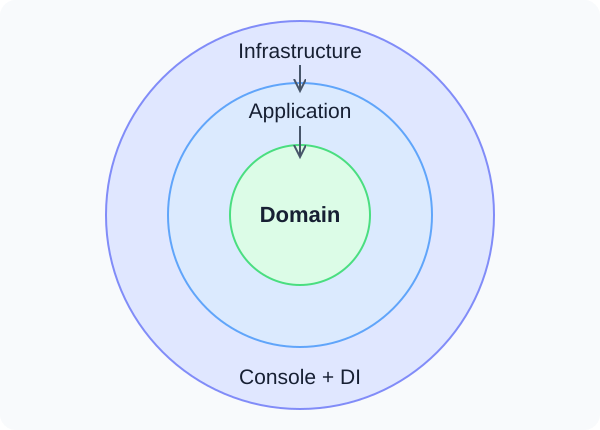

# ПОС

Консольное приложение для оценки студентов одного курса.

## Запуск

```sh
dotnet run --project Pos.Console -- ./data
dotnet test Pos.Tests/Pos.Tests.csproj
```

## Команды

После номера команды вводите значения по одному в строке. Студента и критерий выбирайте по номеру из показанного списка.

| Команда | Действие | Что вводить |
| --- | --- | --- |
| 1 | Добавить студента | Имя, например `Анна` |
| 2 | Добавить критерий | Название, максимум, вес: `Проект`, `20`, `3` |
| 3 | Посмотреть ведомость | Ничего |
| 4 | Выставить оценку | Номер студента, номер критерия, балл, комментарий |
| 5 | Исправить оценку | Номер студента, номер критерия, новый балл, комментарий |
| 6 | Отменить оценку | Номер студента, номер критерия |
| 7 | Посчитать итоги | Ничего |
| 8 | Экспортировать итоги | Путь к новому файлу, например `./results.csv` |
| 9 | Переименовать студента | Номер студента, новое имя |
| 10 | Удалить студента | Номер студента |
| 11 | Изменить критерий | Номер критерия, новое название, максимум, вес |
| 12 | Удалить критерий | Номер критерия |
| 0 | Выйти | Ничего |

Числа допускают точку или запятую: `7.5`, `7,5`. Максимум и вес положительные, балл от нуля до максимума. Комментарий можно оставить пустым, нажав Enter.

Пример ввода для новой ведомости: создать студента и критерий, поставить 8 из 10, получить итог и экспортировать его.

```text
1
Анна
2
Проект
10
1
4
1
1
8
Хорошая работа
7
8
./results.csv
0
```

Итог примера: `8`. Файл экспорта не должен существовать заранее.

## Onion Architecture



| Проект | Ответственность | Зависимости |
| --- | --- | --- |
| `Pos.Domain` | Модель, инварианты, расчёт и порт репозитория | Стандартная библиотека .NET |
| `Pos.Application` | Сценарии и проекции для UI | Domain |
| `Pos.Infrastructure` | JSON, CSV и преобразование снимков в домен | Application, Domain |
| `Pos.Console` | Ввод, вывод и сборка зависимостей | Application, Infrastructure |

Зависимости направлены внутрь: Application → Domain; Infrastructure → Application и Domain. Ссылка Console на Infrastructure нужна для регистрации адаптеров через DI. Domain не зависит от файлов, JSON, консоли и DI-контейнера.

## DDD

### Язык предметной области

| Понятие | Тип или свойство | Роль |
| --- | --- | --- |
| Студент | `StudentProfile` | Кого оценивают |
| Критерий | `AssessmentCriterion` | За что оценивают; содержит название, максимум и вес |
| Рубрикатор | `AssessmentLedger.Criteria` | Набор критериев курса |
| Оценка | `StudentEvaluation` | Балл студента по критерию и необязательный комментарий |
| Балл | `Score` | Неотрицательное числовое значение |
| Итог | `FinalResult` | Вычисленный результат студента |
| Ведомость | `AssessmentLedger` | Студенты, рубрикатор и оценки одного курса |

### Entity и Value Object

`StudentProfile` и `AssessmentCriterion` являются Entity: их идентичность задаётся ID. Переименование студента сохраняет его ID; два студента с одинаковым именем имеют разные ID. Идентичность `StudentEvaluation` задаётся парой StudentId/CriterionId. Сущности сопоставляются явно по идентификаторам.

`Score` является Value Object: у него нет ID, он неизменяем и сравнивается по значению. Например, `new Score(5)` равен другому `new Score(5)`. Отрицательное значение создать нельзя.

### Агрегат и инварианты

`AssessmentLedger` является корнем агрегата. Все изменения проходят через него; коллекции доступны только для чтения, дочерние сущности неизменяемы. При редактировании корень заменяет сущность, сохраняя её ID.

Модель проверяет:

- Непустые и уникальные ID, непустые имена и названия.
- Положительные максимум и вес критерия.
- Балл в диапазоне от нуля до максимума критерия.
- Наличие студента и критерия в этой ведомости.
- Одну оценку на пару студент/критерий.
- Запрет удаления объектов с оценками и снижения максимума ниже выставленного балла.

Один агрегат позволяет проверять связи и сохранять ведомость согласованно. Это компромисс для одного небольшого курса: каждое изменение загружает и сохраняет всю ведомость. Несколько курсов и история оценок не поддерживаются. Изменение рубрикатора пересчитывает текущие итоги.

### Repository и Domain Service

`ILedgerStore` задаёт порт хранения внутри Domain. `JsonLedgerStore` реализует его в Infrastructure, поэтому домен не знает формат и место хранения. `Load` возвращает независимый снимок, `Save` проверяет его актуальность, `Update` выполняет изменение с сохранением под одной блокировкой.

`WeightedResultCalculator` является Domain Service: итог зависит от оценок студента и всего рубрикатора, поэтому расчёт не принадлежит одной сущности. Итог вычисляется заново и остаётся согласованным с текущими данными. Правила находятся в Domain, Application управляет последовательностью сценария.

## DI

Зависимости передаются через конструкторы. Например, `AssessmentOperations` получает `ILedgerStore`, `WeightedResultCalculator` и `IFileReportExporter`, а калькулятор получает `IMissingEvaluationPolicy`. Сервисы не создают адаптеры самостоятельно.

Контейнер `Microsoft.Extensions.DependencyInjection` настраивается в `Pos.Console/Program.cs`, в точке сборки приложения (composition root):

| Регистрация | Реализация |
| --- | --- |
| `ILedgerStore` | `JsonLedgerStore` с выбранным каталогом |
| `IFileReportExporter` | `CsvReportWriter` |
| `IMissingEvaluationPolicy` | `RequireAllCriteriaPolicy` или `MissingAsZeroPolicy` |
| `WeightedResultCalculator` | Доменный калькулятор |
| `AssessmentOperations` | Фасад сценариев |

Все регистрации используют `AddSingleton`: один экземпляр сервиса на время работы консоли. Для хранилища это также означает одну файловую блокировку. `BuildServiceProvider` создаёт провайдер, а `GetRequiredService<AssessmentOperations>()` разрешает весь граф зависимостей. При завершении `using` провайдер освобождает `JsonLedgerStore` и файловую блокировку.

Замена JSON-хранилища или политики требует изменения регистрации на внешней границе, а не доменных правил. В тестах Application работает и с независимым `MemoryLedgerStore`.

## Паттерны

| Группа | Паттерн | Где | Зачем |
| --- | --- | --- | --- |
| Порождающие | Фабрика | `StudentEvaluation.Create` | Единая проверка связей и допустимости балла при создании и исправлении оценки; конструктор закрыт |
| Структурные | Facade | `AssessmentOperations` | Консоль вызывает готовые сценарии, не управляя загрузкой, сохранением и сборкой представлений |
| Поведенческие | Strategy | `IMissingEvaluationPolicy` | Обработка пропусков заменяется без изменения калькулятора |

Фабрика реализована статическим фабричным методом. `RequireAllCriteriaPolicy` не даёт итог при пропуске, `MissingAsZeroPolicy` подставляет ноль. Паттерны используются в рабочих сценариях, а не только объявлены в коде.

## Итог и хранение

```text
итог = round(10 × Σ(вес × балл / максимум) / Σ(вес), 2)
```

Округление до двух знаков, середина от нуля. Без всех оценок итог не вычисляется. Вариант с нулями за пропуски: `dotnet run --project Pos.Console -- ./data --missing=zero`. Пустой рубрикатор не даёт итога.

Данные сохраняются в `./data/gradebook.json`, итоги экспортируются в CSV. Запись через временный файл защищает от частичного результата. Устаревший снимок не перезаписывает новые данные. Один каталог открывается только одним экземпляром приложения.

## Проверки

30 тестов xUnit:

| Файл | Что проверяется |
| --- | --- |
| `DomainChecks.cs` | Инварианты, неизменяемость, политики пропусков, веса и округление |
| `StorageChecks.cs` | JSON, независимость снимков, конфликты, параллельные изменения и отказы записи |
| `ApplicationChecks.cs` | Сценарии, перезапуск и работа с другим адаптером хранения |
| `ExportChecks.cs` | Экранирование CSV, защита формул, запрет перезаписи и сбой экспорта |
| `ConsoleChecks.cs` | Отдельный процесс консоли: CRUD, экспорт, неверный ввод и повреждение данных |